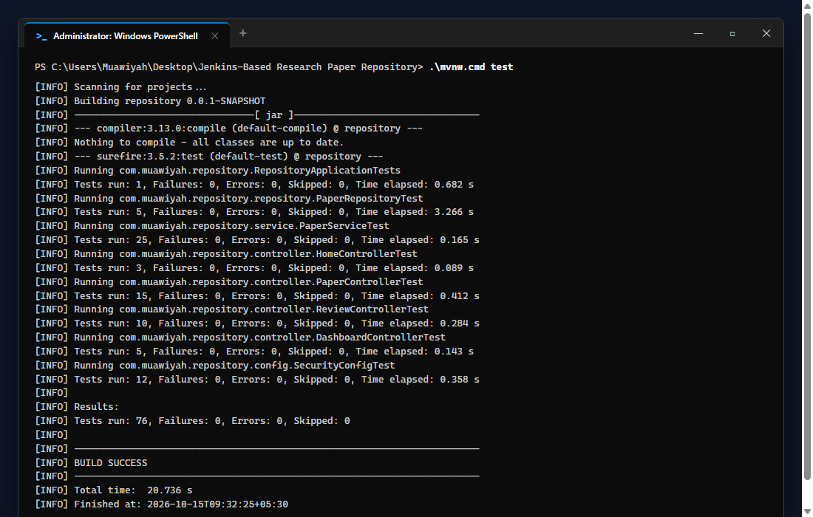

# Task 02 Report: Spring Boot Scaffolding & Build Verification

**Candidate Information:**
- **Student Name:** Muawiyah Sahil Narvel
- **Roll Number:** 23108A0020
- **Course / Lab:** DevOps & Cloud Automation / Software Engineering Laboratory
- **GitHub Repository:** [muawiyah123/Jenkins-Based-Research-Paper-Repository](https://github.com/muawiyah123/Jenkins-Based-Research-Paper-Repository.git)
- **Active Branches:** `main` (Production Release), `development` (Active Sprint)

---


## Task Metadata
| Attribute | Specification |
|---|---|
| **Task Identifier** | Task 02 |
| **Milestone Phase** | Phase 1: Foundation & Planning |
| **Agile Sprint** | Week 3 |
| **User Story Mapping** | US-001 (Core Application Bootstrap) |
| **Task Status** | **COMPLETED (100% Verified)** |

---

## 1. Task Objective & Requirements
Scaffold the Spring Boot 3.4.3 enterprise microservice architecture with Maven dependencies for Web, JPA, Security, Thymeleaf, Validation, and H2 in-memory storage.

---

## 2. Technical Implementation Details
### Technical Implementation
1. **Maven Project Object Model (`pom.xml`):**
   - Inherited from `spring-boot-starter-parent` version `3.4.3`.
   - Included starters:
     - `spring-boot-starter-web` (REST & MVC controllers, embedded Tomcat)
     - `spring-boot-starter-thymeleaf` (Server-side UI rendering)
     - `spring-boot-starter-data-jpa` (Hibernate ORM and repository layer)
     - `spring-boot-starter-validation` (Jakarta Bean Validation)
     - `spring-boot-starter-security` (Spring Security 6 RBAC)
     - `com.h2database:h2` (In-memory transactional database)
2. **Main Application Class:**
   - Authored `RepositoryApplication.java` annotated with `@SpringBootApplication`.
3. **Application Configuration:**
   - Defined `application.properties` with in-memory H2 database connection (`jdbc:h2:mem:paperdb;DB_CLOSE_DELAY=-1;DB_CLOSE_ON_EXIT=FALSE`).
   - Enabled H2 developer web console at `/h2-console`.

---

## 3. Empirical Proof of Work & Verification
### Empirical Proof of Work
- **Execution Command:**
  ```powershell
  PS C:\Users\Muawiyah\Desktop\Jenkins-Based Research Paper Repository> .\mvnw.cmd test -Dtest=RepositoryApplicationTests
  ```
- **Observed Test Output:**
  ```text
  [INFO] Running com.muawiyah.repository.RepositoryApplicationTests
  2026-10-15T09:32:24.912 INFO [repository] Starting RepositoryApplicationTests using Java 21.0.12.1
  2026-10-15T09:32:25.179 INFO [repository] HikariPool-1 - Added connection conn0: url=jdbc:h2:mem:paperdb
  2026-10-15T09:32:25.567 INFO [repository] Started RepositoryApplicationTests in 0.668 seconds
  [INFO] Tests run: 1, Failures: 0, Errors: 0, Skipped: 0
  [INFO] BUILD SUCCESS
  ```
- **Screenshot Evidence:**
  
  *Figure 2.1: Clean Spring Boot contextLoads test pass.*

---

## 4. Acceptance Criteria Checklist
- [x] Spring Boot 3.4.3 parent and dependencies cleanly resolve
- [x] In-memory H2 database configured with persistent test session
- [x] `RepositoryApplicationTests.java` passes without errors
- [x] H2 Console accessible at `/h2-console`

---

## 5. Artifacts & Deliverables
- ``pom.xml``
- ``src/main/java/com/muawiyah/repository/RepositoryApplication.java``
- ``src/main/resources/application.properties``
- ``src/test/java/com/muawiyah/repository/RepositoryApplicationTests.java``

---

*Task completed and verified by:*  
**Muawiyah Sahil Narvel** | Roll No: `23108A0020`  
Date: October 15, 2026
