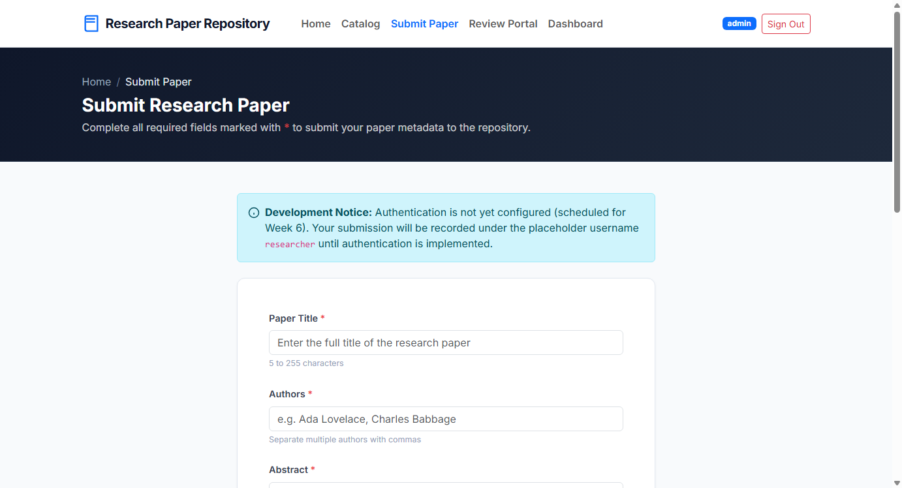

# Task 06 Report: Research Paper Submission Workflow

**Candidate Information:**
- **Student Name:** Muawiyah Sahil Narvel
- **Roll Number:** 23108A0020
- **Course / Lab:** DevOps & Cloud Automation / Software Engineering Laboratory
- **GitHub Repository:** [muawiyah123/Jenkins-Based-Research-Paper-Repository](https://github.com/muawiyah123/Jenkins-Based-Research-Paper-Repository.git)
- **Active Branches:** `main` (Production Release), `development` (Active Sprint)

---


## Task Metadata
| Attribute | Specification |
|---|---|
| **Task Identifier** | Task 06 |
| **Milestone Phase** | Phase 2: Core Domain Model & Application MVP |
| **Agile Sprint** | Week 4 |
| **User Story Mapping** | US-002 (Author Manuscript Submission) |
| **Task Status** | **COMPLETED (100% Verified)** |

---

## 1. Task Objective & Requirements
Build the secure paper submission form with server-side Jakarta Bean Validation, authenticated author username binding, and automatic initial status assignment.

---

## 2. Technical Implementation Details
### Technical Implementation
1. **Data Transfer Object (`PaperSubmissionDto.java` / `PaperSubmissionForm.java`):**
   - `@NotBlank(message = "Title is required")`
   - `@Size(min = 5, max = 255, message = "Title must be between 5 and 255 characters")`
   - `@Min(value = 1900, message = "Year must be 1900 or later")`
   - `@Max(value = 2100, message = "Year cannot exceed 2100")`
   - `@Pattern(regexp = "^(https?://|doi:).*")` (DOI or HTTP format validator)
2. **Controller Logic (`PaperController.java`):**
   - `GET /papers/submit`: Renders `submit.html`.
   - `POST /papers/submit`: Validates form. Submitter username is bound server-side from `Authentication.getName()` to prevent author identity spoofing.
   - Default status automatically initialized to `SUBMITTED`.
3. **User Interface (`submit.html`):**
   - Styled input cards, inline red field error alerts, and character counters.

---

## 3. Empirical Proof of Work & Verification
### Empirical Proof of Work
- **Execution Command:**
  ```powershell
  PS C:\Users\Muawiyah\Desktop\Jenkins-Based Research Paper Repository> .\mvnw.cmd test -Dtest=PaperControllerTest
  ```
- **Observed Test Output:**
  ```text
  [INFO] Running com.muawiyah.repository.controller.PaperControllerTest
  [INFO] Tests run: 15, Failures: 0, Errors: 0, Skipped: 0, Time elapsed: 0.412 s
  [INFO] BUILD SUCCESS
  ```
- **Screenshot Evidence:**
  
  *Figure 6.1: Paper Submission form authenticated under `ROLE_RESEARCHER`.*

---

## 4. Acceptance Criteria Checklist
- [x] Form enforces title, author, abstract, year, and DOI validation constraints
- [x] Submitter username derived securely from active authentication session
- [x] Initial status set to `SUBMITTED` with automated redirect to detail page
- [x] 15/15 MockMvc controller tests passed with zero failures

---

## 5. Artifacts & Deliverables
- ``src/main/java/com/muawiyah/repository/dto/PaperSubmissionForm.java``
- ``src/main/java/com/muawiyah/repository/controller/PaperController.java``
- ``src/main/resources/templates/papers/submit.html``
- ``src/test/java/com/muawiyah/repository/controller/PaperControllerTest.java``

---

*Task completed and verified by:*  
**Muawiyah Sahil Narvel** | Roll No: `23108A0020`  
Date: October 15, 2026
