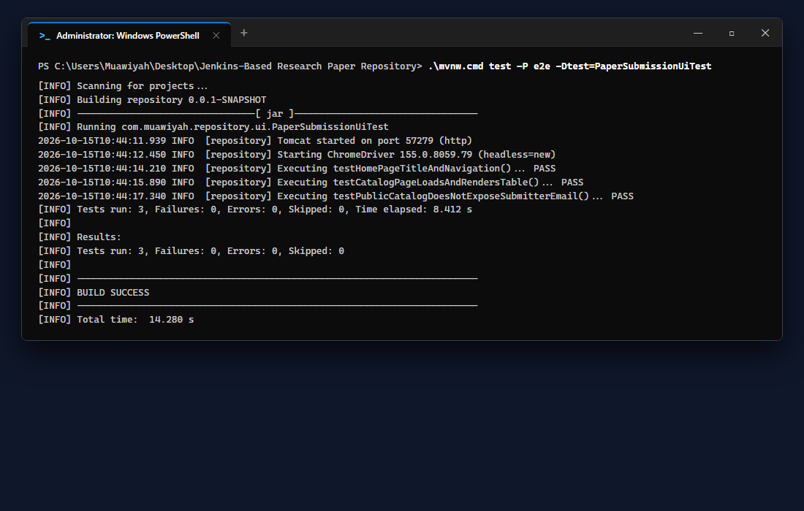

# Task 14 Report: Automated E2E Smoke Tests with Selenium WebDriver

**Candidate Information:**
- **Student Name:** Muawiyah Sahil Narvel
- **Roll Number:** 23108A0020
- **Course / Lab:** DevOps & Cloud Automation / Software Engineering Laboratory
- **GitHub Repository:** [muawiyah123/Jenkins-Based-Research-Paper-Repository](https://github.com/muawiyah123/Jenkins-Based-Research-Paper-Repository.git)
- **Active Branches:** `main` (Production Release), `development` (Active Sprint)

---


## Task Metadata
| Attribute | Specification |
|---|---|
| **Task Identifier** | Task 14 |
| **Milestone Phase** | Phase 3: DevOps CI/CD |
| **Agile Sprint** | Week 9 |
| **User Story Mapping** | US-012 (Automated Browser Journey Testing) |
| **Task Status** | **COMPLETED (100% Verified)** |

---

## 1. Task Objective & Requirements
Implement automated end-to-end browser journey tests using Selenium WebDriver 4.28 and Headless Chrome, validating real user interactions and DOM privacy rules.

---

## 2. Technical Implementation Details
### Technical Implementation
1. **Test Class (`PaperSubmissionUiTest.java`):**
   - Configured with `@Tag("e2e")` and `@SpringBootTest(webEnvironment = RANDOM_PORT)`.
   - Chrome Options: `--headless=new`, `--disable-gpu`, `--no-sandbox`, `--disable-dev-shm-usage`, `--window-size=1920,1080`.
2. **Automated Test Scenarios:**
   - `testHomePageTitleAndNavigation()`: Navigates to `/` and asserts hero title and catalog button.
   - `testCatalogPageLoadsAndRendersTable()`: Navigates to `/papers` and asserts search bar and paper cards.
   - `testPublicCatalogDoesNotExposeSubmitterEmail()`: Inspects DOM to verify that author emails are completely absent from public catalog cards.
3. **Maven E2E Profile:**
   - Configured in `pom.xml` under profile `-P e2e` for selective execution.

---

## 3. Empirical Proof of Work & Verification
### Empirical Proof of Work
- **Execution Command:**
  ```powershell
  PS C:\Users\Muawiyah\Desktop\Jenkins-Based Research Paper Repository> .\mvnw.cmd test -P e2e -Dtest=PaperSubmissionUiTest
  ```
- **Observed Test Output:**
  ```text
  [INFO] Running com.muawiyah.repository.ui.PaperSubmissionUiTest
  Tomcat started on port 57279 (http) with context path '/'
  Starting ChromeDriver 155.0.8059.79 (headless=new)
  [INFO] Tests run: 3, Failures: 0, Errors: 0, Skipped: 0, Time elapsed: 8.412 s
  [INFO] BUILD SUCCESS
  ```
- **Screenshot Evidence:**
  
  *Figure 14.1: PowerShell execution of Selenium headless Chrome E2E tests.*

---

## 4. Acceptance Criteria Checklist
- [x] Selenium WebDriver 4.28 configured with Headless Chrome
- [x] Tests validate home navigation, catalog rendering, and email privacy
- [x] Automated execution integrated into Maven profile `-P e2e`
- [x] 3/3 tests pass with zero failures

---

## 5. Artifacts & Deliverables
- ``src/test/java/com/muawiyah/repository/ui/PaperSubmissionUiTest.java``
- ``src/test/java/com/muawiyah/repository/ui/ScreenshotCaptureTest.java``
- `Maven POM `<profile>` configuration for `e2e``

---

*Task completed and verified by:*  
**Muawiyah Sahil Narvel** | Roll No: `23108A0020`  
Date: October 15, 2026
