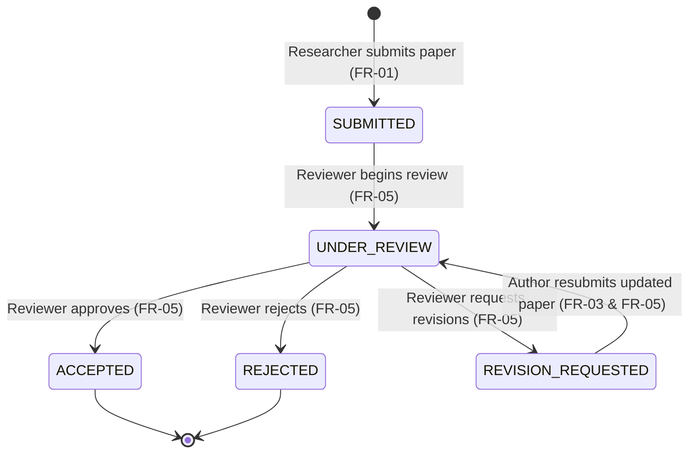

# Software Requirements Specification (SRS)
## Jenkins-Based Research Paper Repository

**Student Name:** Muawiyah Narvel  
**Roll Number:** 23108A0020  
**Project Title:** Jenkins-Based Research Paper Repository  
**Academic Milestone:** Weeks 1–3 Foundation  
**Document Reference:** `docs/week-01/software-requirements-specification.md`  
**Status:** Approved SRS Baseline (Subject to Faculty Confirmation of Flagged Items)  

---

## 1. Introduction

### 1.1 Purpose
This Software Requirements Specification (SRS) establishes the formal functional and non-functional requirements, data dictionary, validation constraints, review state machine, and planned DevOps integration points for the **Jenkins-Based Research Paper Repository**. It provides an unambiguous specification for implementation, testing, and academic evaluation.

### 1.2 Intended Audience
- **Faculty Examiners & Supervisors:** For syllabus verification, architectural scoring, and viva assessment.
- **Student Developer:** As the single source of truth for incremental development, testing, and evidence collection.

### 1.3 Scope of the Product
The system is an institutional web application for managing academic research paper metadata, executing peer-review workflows, and viewing repository metrics. In later weeks, an automated CI/CD pipeline (Jenkins, Docker, Selenium, Ansible) will be introduced to automate build verification and deployment.

---

## 2. Intended Users & Role Definitions

| Role / Access Tier | Authentication Required | Capabilities & Access Permissions |
| :--- | :--- | :--- |
| **Public / Unauthenticated Visitor** | **No (Public Access)** | Can freely browse the public paper catalog (`GET /papers`), search papers by title/author/keyword (`GET /papers/search`), and view individual paper details and abstracts (`GET /papers/{id}`) without logging in. Public views **never expose submitterEmail** or other private submitter contact details. |
| **Researcher (R-01)** | **Yes (Role: `ROLE_RESEARCHER`)** | Inherits public browsing capabilities; can submit new research paper records (`FR-01`); can edit metadata of own submissions while in `SUBMITTED` or `REVISION_REQUESTED` status (`FR-03`); can trigger resubmission (`FR-05`); can access the summary dashboard (`FR-06`). Cannot edit papers under active review or finalized. |
| **Reviewer (R-02)** | **Yes (Role: `ROLE_REVIEWER`)** | Inherits public browsing capabilities; can inspect abstracts and review queues; can manage paper review statuses (`FR-05`); can access the summary dashboard (`FR-06`). Cannot edit researcher-authored metadata. Submitter email is not exposed on review interfaces unless required by faculty rubric. |
| **Administrator (R-03)** | **Yes (Role: `ROLE_ADMIN`)** | Can authenticate into the application and view the summary dashboard metrics (`FR-06`). *(Note: Record deletion, administrator status overrides, audit logs, and user-role configuration management are explicitly excluded from the MVP).* |

---

## 3. Data Dictionary: Paper Entity Specification

| Field Name | Java Type | DB Column Type | Mandatory | Validation Constraints & Rules |
| :--- | :--- | :--- | :--- | :--- |
| `id` | `Long` | `BIGINT` | Yes (Auto) | Primary key, generated automatically by database sequence. |
| `title` | `String` | `VARCHAR(255)` | Yes | 5 to 255 characters; trimmed, cannot be blank. |
| `authors` | `String` | `VARCHAR(500)` | Yes | Comma-separated list of author full names; 2 to 500 characters. |
| `abstractText` | `String` | `TEXT` / `CLOB` | Yes | 20 to 5000 characters; comprehensive summary of research. |
| `keywords` | `String` | `VARCHAR(255)` | Yes | Comma-separated keywords; 2 to 255 characters. |
| `publicationYear` | `Integer` | `INT` | Yes | Valid year range: `1900` to `Current Year + 1`. |
| `doiUrl` | `String` | `VARCHAR(255)` | No | Optional URL or DOI string (e.g., `https://doi.org/...`). |
| `submitterEmail` | `String` | `VARCHAR(150)` | Yes | Author contact email metadata. Validated for RFC 5322 syntax. *Contact field only; does not establish ownership and is never exposed on public pages.* |
| `submitterUsername` | `String` | `VARCHAR(50)` | Yes (Auto) | Authenticated account identity populated server-side from `Authentication.getName()` upon creation. **Authoritative source of paper ownership.** |
| `reviewStatus` | `ReviewStatus` | `VARCHAR(30)` | Yes | Enum: `SUBMITTED`, `UNDER_REVIEW`, `ACCEPTED`, `REJECTED`, `REVISION_REQUESTED`. Default: `SUBMITTED`. |
| `createdAt` | `LocalDateTime`| `TIMESTAMP` | Yes (Auto) | Timestamp set automatically upon record creation. |
| `updatedAt` | `LocalDateTime`| `TIMESTAMP` | Yes (Auto) | Timestamp updated automatically whenever record is modified. |

### 3.1 Account Identity vs. Contact Email & Development Usernames
In this system, authenticated account identity is the sole source of paper ownership, while `submitterEmail` is strictly a contact metadata field. A client-supplied email address is never treated as proof of ownership or authorization.

During development, Spring Security is configured with three in-memory accounts:
- `researcher` (Role: `ROLE_RESEARCHER`): Submits papers; `submitterUsername` is assigned `'researcher'` directly by the backend from `Authentication.getName()`.
- `reviewer` (Role: `ROLE_REVIEWER`): Inspects review queues and updates review statuses; cannot edit researcher-authored metadata.
- `admin` (Role: `ROLE_ADMIN`): Authenticates to view system metrics on the dashboard.

When an edit (`FR-03`) or resubmission (`FR-05`) is requested, the server verifies `Authentication.getName().equals(paper.getSubmitterUsername())`. Client-supplied form parameters cannot alter or forge this ownership attribution.

---

## 4. Review Status State Machine & Role Transitions

### 4.1 Permitted Status Values
- `SUBMITTED`: Newly registered paper metadata; awaiting reviewer inspection.
- `UNDER_REVIEW`: Paper is under active peer evaluation.
- `ACCEPTED`: Paper meets publication/departmental standards (terminal state).
- `REJECTED`: Paper does not meet publication standards (terminal state).
- `REVISION_REQUESTED`: Paper requires author amendments before re-evaluation.

### 4.2 State Transition Matrix

### 4.3 Transition and Resubmission Rules
1. **Reviewer Operations:** Only authenticated users with the `Reviewer` role (`ROLE_REVIEWER`) may execute the following transitions:
   - `SUBMITTED` → `UNDER_REVIEW`
   - `UNDER_REVIEW` → `ACCEPTED`
   - `UNDER_REVIEW` → `REJECTED`
   - `UNDER_REVIEW` → `REVISION_REQUESTED`
2. **Researcher Resubmission:** When a paper is in `REVISION_REQUESTED` status, the authenticated `Researcher` (`ROLE_RESEARCHER`) who submitted the paper may update its metadata (`FR-03`). The server verifies ownership against the authenticated principal. Submitting this update automatically transitions the status from `REVISION_REQUESTED` back to `UNDER_REVIEW`.
3. **Terminal States:** `ACCEPTED` and `REJECTED` are final immutable states in the MVP. No further status changes or metadata edits are permitted once a paper enters either state.
4. **Server-Side Enforcement:** Any attempt to perform an unauthorized transition or out-of-order transition (such as jumping from `SUBMITTED` directly to `ACCEPTED`) must be rejected server-side with an HTTP 400 (Bad Request) or HTTP 403 (Forbidden) response.

---

## 5. Functional Requirements (Application MVP Baseline: Planned for Weeks 4–7 Implementation)

The core application requirements (**FR-01** through **FR-08**) are formally documented during Weeks 1–3 and scheduled for implementation during Weeks 4–7:

| Requirement ID | Name | Access Level | Description | Priority |
| :--- | :--- | :--- | :--- | :--- |
| **FR-01** | Create Paper Record | Authenticated (`ROLE_RESEARCHER`) | Provide a validated web form allowing Researchers to submit paper metadata (title, authors, abstract, keywords, publication year, optional DOI, submitter email). Initial status is set to `SUBMITTED`. Submitter identity is derived server-side from the authenticated security principal. | Mandatory (MVP) |
| **FR-02** | Catalog Listing & Detail View | **Public (No login required)** | Display a responsive table of all registered papers, and provide a dedicated detail view displaying the complete abstract and full metadata for any selected paper. Publicly accessible to all visitors without exposing `submitterEmail` or private contact details. | Mandatory (MVP) |
| **FR-03** | Edit Paper Metadata | Authenticated (`ROLE_RESEARCHER`, Author only) | Allow Researchers to edit metadata of their own submissions while in `SUBMITTED` or `REVISION_REQUESTED` status. Metadata editing is locked once a paper is `UNDER_REVIEW`, `ACCEPTED`, or `REJECTED`. Reviewers cannot edit researcher metadata. | Mandatory (MVP) |
| **FR-04** | Search & Filtering | **Public (No login required)** | Provide a public search interface allowing any visitor to filter papers by title substring, author name, or keyword with immediate matching results without requiring authentication. | Mandatory (MVP) |
| **FR-05** | Manage Review Status | Authenticated (`ROLE_REVIEWER` or Author for resubmission) | Allow Reviewers to transition review status according to the state machine, and allow Researchers to trigger the `REVISION_REQUESTED` → `UNDER_REVIEW` transition upon valid resubmission. Reject invalid transitions server-side. | Mandatory (MVP) |
| **FR-06** | Dashboard Summary | Authenticated (`ROLE_RESEARCHER`, `ROLE_REVIEWER`, `ROLE_ADMIN`) | Provide a summary dashboard displaying high-level repository metrics with dedicated count cards for all five review statuses plus total: **Total Papers**, **Submitted**, **Under Review**, **Revision Requested**, **Accepted**, and **Rejected**. | Mandatory (MVP) |
| **FR-07** | Backend Authorization for Protected Operations | System Security Configuration | Enforce backend role-based authorization: public endpoints (`/`, `/papers`, `/papers/{id}`, `/papers/search`) are unrestricted; submission, editing, review management, and dashboard require authentication. Ownership of submitted papers is derived/verified on the server from the authenticated security principal (`Authentication.getName()`), rejecting client-supplied identity parameters. Proposed approach: Spring Security with in-memory development accounts (`researcher`, `reviewer`, `admin`), pending faculty confirmation. | Mandatory (MVP) |
| **FR-08** | Database Persistence | System Persistence | Persist paper records in an embedded H2 relational database using Spring Data JPA, ensuring transactional integrity. | Mandatory (MVP) |

---

## 6. Non-Functional Requirements

| Requirement ID | Category | Specification |
| :--- | :--- | :--- |
| **NFR-01** | **Build Automation (Week 3)** | The application must compile, test, and package cleanly via `./mvnw clean package` (or `mvnw.cmd` on Windows) without IDE-specific dependencies. |
| **NFR-02** | **Runtime Target** | The application must execute on **Java 21 LTS** using a stable, LTS-compatible release of Spring Boot 3.x. |
| **NFR-03** | **Continuous Integration (Planned: Weeks 8–10)** | A declarative `Jenkinsfile` will be created in later weeks to automate build and test execution upon Git code push. |
| **NFR-04** | **Automated Test Coverage (Planned Target)** | Service business logic and repository query methods are planned to achieve automated JUnit 5 and Spring Boot Test coverage upon implementation in Weeks 4–7. Test execution will be verified via Maven Surefire during build execution without claiming unverified coverage metrics prematurely. |
| **NFR-05** | **Response Latency (Provisional Target)** | A provisional local-development performance target of under 500 ms is defined for initial `GET /` (home page) and `GET /papers` (catalog list) requests on `localhost:8080`. *Note: Performance depends on the local developer machine environment and is not claimed as achieved until empirically measured in Week 3.* |
| **NFR-06** | **UI Usability & Responsiveness** | The user interface will utilize Bootstrap 5 to render cleanly on standard desktop resolutions (1920x1080) and mobile viewports. |
| **NFR-07** | **Security & Credential Hygiene** | No sensitive passwords, personal roll numbers as secrets, API tokens, or private keys shall be committed to source code or Git history. Verification must systematically inspect tracked files (`git ls-files`), verify `.gitignore` exclusion of secret and local environment files, and audit Git commit history without exposing secret values in evidence logs. |

---

## 7. Input Validation & Error Handling Rules

### 7.1 Input Validation Rules
- **Title:** Blank strings or titles shorter than 5 characters or longer than 255 characters are rejected with: `"Title must be between 5 and 255 characters"`.
- **Publication Year:** Values `< 1900` or `> Current Year + 1` are rejected with: `"Publication year must be between 1900 and next year"`.
- **Abstract:** Shorter than 20 characters or longer than 5000 characters rejected with: `"Abstract must be between 20 and 5000 characters"`.
- **Email:** Syntactically invalid email strings rejected with: `"Please provide a valid submitter email address"`. (Format validation only; does not verify inbox existence or deliverability).

### 7.2 Error Handling
- Validation errors must appear inline next to offending fields using Thymeleaf form binding (`#fields.hasErrors(...)`).
- Requests for non-existent paper IDs must return a friendly HTTP 404 page rather than an unhandled stack trace.
- Unexpected server errors must be caught by a global exception handler (`@ControllerAdvice`) rendering a generic, styled error page.

---

## 8. Database Architecture & In-Memory Data Reset Notice
- **Engine:** Embedded H2 Database running in in-memory mode (`jdbc:h2:mem:paperdb`).
- **Data Ephemerality Notice:** Because H2 is configured in-memory during early development, **all persisted paper records are lost when the application is stopped or restarted**. This is intentional for early zero-dependency development and automated test isolation. A file-based persistence mode or external PostgreSQL container will be evaluated for persistent storage in later weeks.

---

## 9. Scope Boundaries

### 9.1 Phased Implementation Scope
- **Weeks 1–3 Foundation Milestone:** Formal requirements specification and architecture documentation; minimal Spring Boot 3 + Java 21 project scaffold; responsive home page with placeholder navigation (navigation links to unbuilt features must remain inert/safe placeholders and not expose unbuilt protected routes); Maven Wrapper verification; clean Git repository initialization (`main` branch, `.gitignore`, initial commit).
- **Weeks 4–7 Application MVP Implementation:** Functional implementation and persistence of requirements **FR-01 through FR-08** (H2 database schema, paper metadata creation, catalog browsing, detail viewing, metadata editing, and review status management; record deletion is explicitly excluded from the MVP scope in agreement with Section 9.2, public search, review state machine, metrics dashboard, server-side role authorization, and validation).
- **Weeks 8–15 Planned DevOps Pipeline & Final Milestones:** Automation of CI/CD (`Jenkinsfile`), browser automation (Selenium), containerization (Docker), configuration management (Ansible), and final viva portfolio preparation.

### 9.2 Excluded from MVP (Post-MVP / Future Milestones)
- Paper record deletion and soft-delete capabilities.
- Administrator status overrides, system configuration consoles, and historical audit log tables.
- Dynamic user registration, password self-service, and user-role management UI.
- Direct PDF binary parsing, OCR, or file attachment streaming.
- Plagiarism checking or external AI integrations.
- Multi-node clustering or Kubernetes orchestration.

### 9.3 Planned DevOps Tooling (Weeks 8–15)
- **Jenkins:** CI/CD pipeline automation (`Jenkinsfile`).
- **Selenium WebDriver:** Automated browser end-to-end smoke testing.
- **Docker:** Application containerization.
- **Ansible:** Automated server configuration management.
*(These remain planned items until implemented and verified in their designated weeks).*

---

## 10. System Acceptance Criteria & Week 3 Acceptance Gate

### 10.1 Week 3 Milestone Acceptance Gate
1. Project compiles and packages cleanly using `mvnw.cmd clean package` on Windows with 0 compilation errors.
2. The default Spring Boot context-load test (`contextLoads()`) executes and passes with 0 failures and 0 errors via `mvnw.cmd clean test`. *(Note: Domain business logic, CRUD workflows, review transitions, and JPA persistence tests are planned for implementation and verification during Weeks 4–7).*
3. The application starts up locally on port 8080 without runtime exceptions.
4. Navigating to `http://localhost:8080/` loads the responsive home page with HTTP status 200; placeholder navigation links to unbuilt features remain inert/safe and do not expose unbuilt protected routes.
5. Project structure is organized cleanly with Git initialized on `main` branch, `.gitignore` active, and a clean initial commit recorded without secret leakage.

### 10.2 Application MVP Acceptance Criteria (Planned for Weeks 4–7)
1. Unauthenticated visitors can browse the catalog listing and execute title/author/keyword searches without login prompts; private submitter contact details are never exposed.
2. Submitting valid paper data by an authenticated Researcher creates an H2 database record retrievable from the catalog listing, with submitter ownership derived from the security principal (`submitterUsername`).
3. Submitting invalid inputs triggers descriptive validation messages without application crash.
4. Permitted status transitions update the database; illegal or unauthorized status transitions return an HTTP 400 or HTTP 403 error.
5. Attempting to edit metadata of a paper that is in `UNDER_REVIEW`, `ACCEPTED`, or `REJECTED` is blocked server-side.
6. Dashboard displays accurate counts for Total Papers, `SUBMITTED`, `UNDER_REVIEW`, `REVISION_REQUESTED`, `ACCEPTED`, and `REJECTED`.
7. Provisional local response latency target (< 500 ms for `GET /` and `GET /papers`) is empirically measured and recorded upon feature completion.

---

## 11. Faculty Clarification Items
1. **Deployment Architecture:** Confirm whether an embedded Tomcat server containerized inside Docker behind an Nginx reverse proxy satisfies the college syllabus requirement for "Tomcat/Nginx deployment".
2. **Database Engine:** Confirm whether an embedded/file-backed H2 database satisfies college evaluation criteria, or if a dedicated PostgreSQL instance must be demonstrated.
3. **Security Model:** Confirm whether in-memory development user accounts (`researcher`, `reviewer`, `admin`) are acceptable for the initial security evaluation.
4. **Ansible Target-Host Environment:** Confirm the intended target host environment (local VM, secondary physical machine, or container host) for executing Ansible configuration management playbooks.
