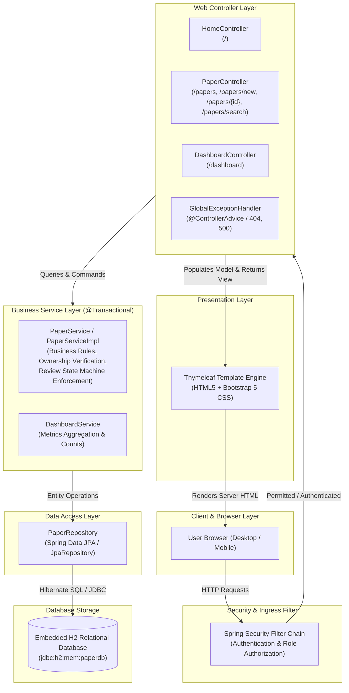
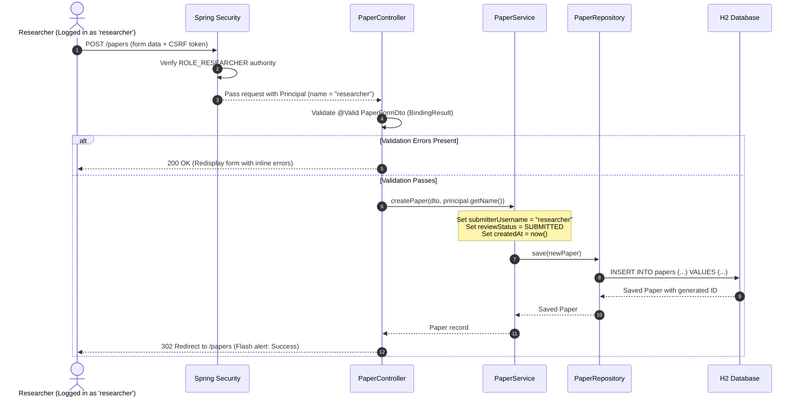
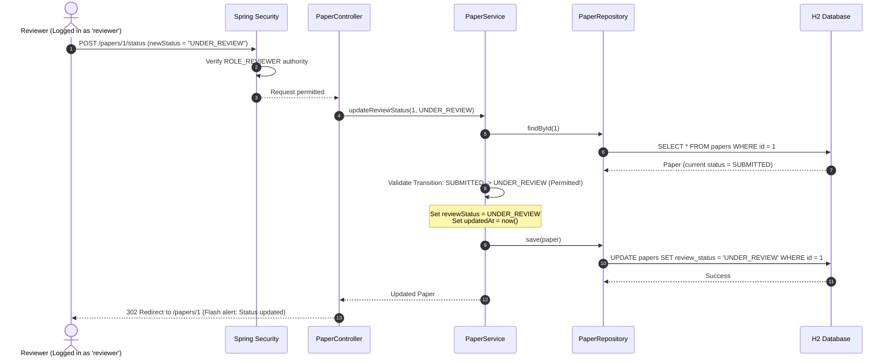
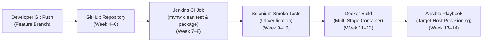

# Application Architecture & Component Design
## Jenkins-Based Research Paper Repository

**Student Name:** Muawiyah Narvel  
**Roll Number:** 23108A0020  
**Project Title:** Jenkins-Based Research Paper Repository  
**Document Reference:** `docs/week-02/architecture.md`  
**Status:** Approved Architecture Baseline (Week 2 Milestone)  

---

## 1. System Overview & Architectural Paradigm

The **Jenkins-Based Research Paper Repository** is designed as a **modular layered monolith** built on **Spring Boot 3.x** and **Java 21 LTS**. 

### 1.1 Why a Layered Monolith?
For an institutional academic repository developed by a single student, a monolithic architecture provides the optimal balance of engineering rigor and operational simplicity:
- **Zero Distributed Complexity:** Eliminates network latency, distributed transactions, and microservice orchestration overhead.
- **Strict Separation of Concerns:** Logic is divided cleanly into distinct vertical layers (Presentation, Controller, Service, Repository, Database).
- **Fast Local Feedback:** The entire application boots in seconds on a developer workstation and runs self-contained tests without external dependencies.
- **Ideal CI/CD Target:** A single compiled JAR artifact (`target/*.jar`) simplifies automated Jenkins builds, Docker packaging, and Ansible deployments.

---

## 2. High-Level Architecture Diagram

The diagram below illustrates the layered architecture and component interactions:



---

## 3. Architectural Layers & Responsibilities

### 3.1 Presentation Layer (Thymeleaf & Bootstrap 5)
- **Role:** Server-side HTML5 rendering.
- **Responsibilities:**
  - Consumes Spring MVC `Model` attributes and dynamically renders data using Thymeleaf expressions (`th:text`, `th:each`, `th:if`).
  - Utilizes Bootstrap 5 for responsive layout grids, navigation bars, tables, form controls, and status badges.
  - Implements client privacy rules: strictly avoids rendering `submitterEmail` or private contact data on public pages.
  - Displays inline field validation errors using Thymeleaf form binding (`#fields.hasErrors('fieldName')`).

### 3.2 Controller Layer (Spring MVC `@Controller`)
- **Role:** HTTP request handling and routing.
- **Responsibilities:**
  - Maps incoming HTTP verbs (`GET`, `POST`) to handler methods.
  - Accepts and validates user input via `@Valid @ModelAttribute PaperFormDto`.
  - Injects authenticated user security identity via `Principal` or `Authentication`.
  - Delegates all business logic, ownership checks, and data mutations to the Service layer.
  - Selects the target Thymeleaf view template or issues browser redirects (Post-Redirect-Get pattern).

### 3.3 Service Layer (`@Service`, `@Transactional`)
- **Role:** Business logic, transaction management, and domain rule enforcement.
- **Responsibilities:**
  - **Ownership Verification:** Enforces that `principal.getName()` matches `paper.getSubmitterUsername()` before allowing author edits or resubmissions.
  - **State Machine Enforcement:** Validates review status transitions according to the approved state matrix; rejects illegal forward jumps or modifications to terminal states (`ACCEPTED`, `REJECTED`) by throwing custom domain exceptions.
  - **Data Transformation:** Converts between web DTOs (`PaperFormDto`) and domain entities (`Paper`).
  - **Transaction Boundaries:** Guarantees atomicity via Spring `@Transactional` annotations.

### 3.4 Repository Layer (Spring Data JPA `@Repository`)
- **Role:** Abstraction over relational database persistence.
- **Responsibilities:**
  - Extends `JpaRepository<Paper, Long>`, providing automatic CRUD operations (`save`, `findById`, `findAll`).
  - Defines custom query methods with Spring Data query derivation:
    - Multi-attribute case-insensitive search: `findByTitleContainingIgnoreCaseOrAuthorsContainingIgnoreCaseOrKeywordsContainingIgnoreCase(...)`
    - Dashboard count aggregations: `countByReviewStatus(...)`

### 3.5 Database Layer (Embedded H2)
- **Role:** Relational database storage during development and automated testing.
- **Responsibilities:**
  - Manages table schemas, primary key sequences, and data integrity constraints.
  - Runs in-memory mode (`jdbc:h2:mem:paperdb`) for zero-dependency execution.
  - Includes notice that data resets upon application restart, maintaining clean test isolation.

### 3.6 Security & Configuration Layer (Spring Security)
- **Role:** Authentication, authorization, and route-level protection.
- **Responsibilities:**
  - Configures `SecurityFilterChain` defining public endpoints (`/`, `/papers`, `/papers/{id}`, `/papers/search`, `/css/**`, `/js/**`) vs protected endpoints (`/papers/new`, `/papers/{id}/edit`, `/papers/{id}/status`, `/dashboard`).
  - Manages in-memory development credentials (`researcher`, `reviewer`, `admin`).
  - Supplies the authenticated principal to the web context.

---

## 4. End-to-End Request Flow Scenarios

### Scenario A: Public Catalog Browsing (`GET /papers`)
```mermaid
sequenceDiagram
    autonumber
    actor Visitor as Public Visitor
    participant Sec as Spring Security
    participant Ctrl as PaperController
    participant Svc as PaperService
    participant Repo as PaperRepository
    participant DB as H2 Database
    participant View as Thymeleaf (/papers.html)

    Visitor->>Sec: GET /papers
    Sec-->>Ctrl: Unauthenticated access permitted (Public route)
    Ctrl->>Svc: getAllPapers()
    Svc->>Repo: findAll()
    Repo->>DB: SELECT * FROM papers ORDER BY created_at DESC
    DB-->>Repo: List<Paper> records
    Repo-->>Svc: List<Paper>
    Svc-->>Ctrl: List<Paper>
    Ctrl->>View: Populate Model ("papers") & return "papers/list"
    View-->>Visitor: 200 OK (Rendered HTML table; submitterEmail hidden)
```

### Scenario B: Authenticated Paper Submission with Server-Derived Ownership (`POST /papers`)


### Scenario C: Reviewer Status Transition (`POST /papers/{id}/status`)


---

## 5. Proposed Java Package Structure

To ensure modularity and ease of navigation for beginner development and viva evaluation, the code will reside under `com.muawiyah.repository`:

```text
src/main/java/com/muawiyah/repository/
├── ResearchPaperRepositoryApplication.java  <-- Application entry point (@SpringBootApplication)
│
├── config/                                  <-- Framework & Security configurations
│   ├── SecurityConfig.java                  <-- Spring Security filter chain & in-memory users
│   └── WebMvcConfig.java                    <-- Resource handlers & formatters (if needed)
│
├── controller/                              <-- Web presentation controllers
│   ├── HomeController.java                  <-- Home page (/) handler
│   ├── PaperController.java                 <-- Paper catalog, details, creation, edit, status
│   └── DashboardController.java             <-- Metrics dashboard (/dashboard)
│
├── dto/                                     <-- Form backing objects with validation annotations
│   ├── PaperFormDto.java                    <-- Submission & editing form payload
│   └── StatusUpdateDto.java                 <-- Review status transition payload
│
├── entity/                                  <-- JPA domain models
│   ├── Paper.java                           <-- Relational entity mapping to H2 table
│   └── ReviewStatus.java                    <-- Enum: SUBMITTED, UNDER_REVIEW, etc.
│
├── exception/                               <-- Custom errors and global handling
│   ├── GlobalExceptionHandler.java          <-- @ControllerAdvice for friendly 404/500 rendering
│   ├── ResourceNotFoundException.java       <-- Thrown when paper ID does not exist
│   ├── InvalidStatusTransitionException.java<-- Thrown on illegal state jumps
│   └── UnauthorizedOperationException.java  <-- Thrown when non-author attempts editing
│
├── repository/                              <-- Spring Data JPA interfaces
│   └── PaperRepository.java                 <-- CRUD & derived query methods
│
└── service/                                 <-- Business logic interface & implementation
    ├── PaperService.java                    <-- Interface defining business contract
    ├── impl/
    │   └── PaperServiceImpl.java            <-- Business rules, transaction boundaries
    └── DashboardService.java                <-- Status count aggregations
```

---

## 6. Responsibilities of Major Classes

| Class Name | Type / Stereotype | Key Responsibilities |
| :--- | :--- | :--- |
| `ResearchPaperRepositoryApplication` | `@SpringBootApplication` | Boots the embedded Tomcat container, auto-configures Spring context, and initializes component scanning. |
| `SecurityConfig` | `@Configuration`, `@EnableWebSecurity` | Declares the `SecurityFilterChain` bean; defines public vs protected routes; configures in-memory users (`researcher`, `reviewer`, `admin`) with BCrypt passwords. |
| `HomeController` | `@Controller` | Handles `GET /`; renders the home page with project overview and safe placeholder navigation. |
| `PaperController` | `@Controller` | Handles `GET /papers`, `GET /papers/{id}`, `GET /papers/new`, `POST /papers`, `GET /papers/{id}/edit`, `POST /papers/{id}/edit`, and `POST /papers/{id}/status`. Coordinates DTO validation and flash messages. |
| `DashboardController` | `@Controller` | Handles `GET /dashboard`; queries `DashboardService` for status counts and populates view model. |
| `Paper` | `@Entity`, `@Table` | Maps the 12 fields to relational columns. Includes `@Id @GeneratedValue`, `@CreationTimestamp`, `@UpdateTimestamp`, and JPA lifecycle hooks. |
| `ReviewStatus` | `enum` | Defines the 5 formal review stages: `SUBMITTED`, `UNDER_REVIEW`, `ACCEPTED`, `REJECTED`, `REVISION_REQUESTED`. |
| `PaperFormDto` | POJO DTO | Carries form inputs from browser to controller. Decorated with Jakarta Bean Validation annotations (`@NotBlank`, `@Size`, `@Min`, `@Max`, `@Email`). |
| `PaperService` / `PaperServiceImpl` | `@Service`, `@Transactional` | Executes business rules: checks that user owns paper before editing; validates status transitions; converts DTOs to entities; saves to database. |
| `PaperRepository` | Interface (`JpaRepository`) | Executes SQL queries against H2. Implements `countByReviewStatus` and case-insensitive multi-attribute search queries. |
| `GlobalExceptionHandler` | `@ControllerAdvice` | Intercepts unhandled exceptions (such as `ResourceNotFoundException`) and renders user-friendly `error/404.html` and `error/500.html` views. |

---

## 7. Validation & Authorization Design

### 7.1 Input Validation Architecture
- **Layer:** Form DTO validated at the Controller boundary.
- **Annotations Used:**
  - `@NotBlank(message = "Title is required")`
  - `@Size(min = 5, max = 255, message = "Title must be between 5 and 255 characters")`
  - `@Size(min = 20, max = 5000, message = "Abstract must be between 20 and 5000 characters")`
  - `@Min(value = 1900, message = "Publication year must be 1900 or later")`
  - `@Max(value = 2027, message = "Publication year cannot be in the distant future")`
  - `@Email(message = "Please provide a valid submitter email address")`
- **Error Propagation:** Binding results are inspected; if errors exist, the controller immediately re-renders the form with HTTP 200, binding error text inline using Thymeleaf CSS classes (`is-invalid`).

### 7.2 Authorization Architecture
- **Route-Level Ingress Guards (Spring Security):**
  - Public: `/`, `/papers`, `/papers/{id}`, `/papers/search`, `/css/**`, `/js/**`
  - Authenticated: `/papers/new`, `/papers/**/edit`, `/papers/**/status`, `/dashboard`
- **Role-Level Operation Guards:**
  - Status updates (`POST /papers/{id}/status`): Restricted to `hasRole('REVIEWER')`.
  - Paper submission (`POST /papers`): Restricted to `hasRole('RESEARCHER')`.
- **Domain-Level Ownership Guards (Service Layer):**
  - Metadata editing (`POST /papers/{id}/edit`): Verified inside `PaperServiceImpl` by asserting `paper.getSubmitterUsername().equals(principalName)`. Unauthorized attempts throw `UnauthorizedOperationException`, resulting in an HTTP 403 Forbidden response.

---

## 8. Future DevOps Integration Points (Weeks 4–14)



1. **Apache Maven Build Automation (`mvnw`):**
   - Headless single-command execution via `mvnw.cmd clean verify`.
   - Generates executable JAR under `target/research-paper-repository-*.jar`.
2. **Jenkins CI (`Jenkinsfile` - Weeks 7–8):**
   - Declarative pipeline script located in project root.
   - Triggers automated compilation, Surefire test execution, and artifact archiving upon every Git push.
3. **Selenium WebDriver Automation (Weeks 9–10):**
   - Dedicated test suite in `src/test/java/com/muawiyah/repository/selenium/`.
   - Runs automated headless browser smoke tests asserting critical user paths (browsing, submitting, searching).
4. **Docker Container Packaging (`Dockerfile` - Weeks 11–12):**
   - Multi-stage build using `maven:3.9-eclipse-temurin-21` for compilation and `eclipse-temurin:21-jre-alpine` for the minimal runtime container.
   - Exposes container port `8080`.
5. **Ansible Configuration Management (Weeks 13–14):**
   - Playbook installs prerequisite container packages, opens firewall ports, deploys the application container, and verifies health check endpoints.
