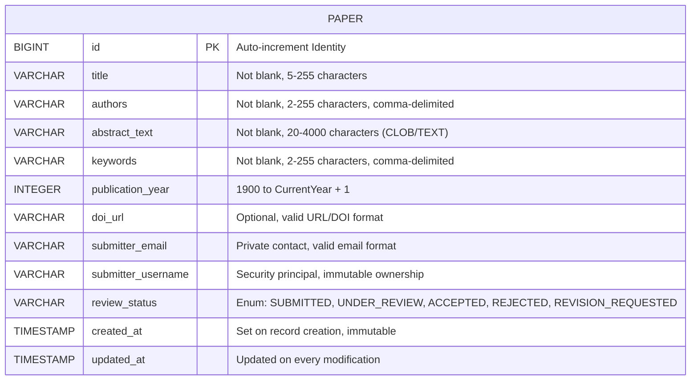
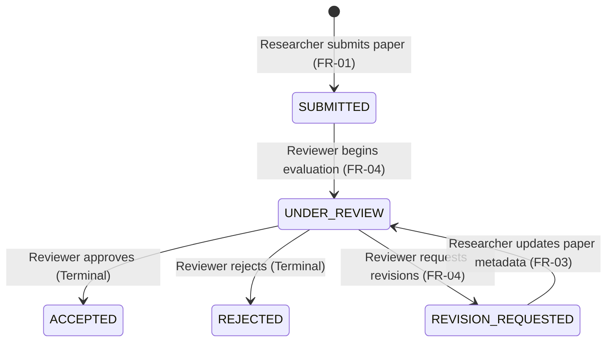

# Database Design and Schema Specification

**Student:** Muawiyah Narvel  
**Roll Number:** 23108A0020  
**Project Title:** Jenkins-Based Research Paper Repository  
**Document Reference:** `docs/week-02/database-design.md`  
**Current Phase:** Week 2 — Architecture & Design Planning  
**Target Milestone:** Weeks 4–7 Application MVP Implementation (Entity Persistence & H2 Storage)

---

## 1. Overview and Storage Strategy

This document specifies the logical and physical database schema for the **Jenkins-Based Research Paper Repository**. 

### 1.1 Development vs. Production Database Strategy
To support rapid prototyping, automated testing, and zero-configuration developer onboarding during **Weeks 1–7**, the repository uses the **H2 in-memory relational database**.

| Characteristic | Development Environment (Weeks 1–7) | Production / CI Pipeline (Weeks 8–14 Plan) |
|---|---|---|
| **Database Engine** | H2 Database Engine (In-Memory mode) | PostgreSQL 16 (Docker Container) |
| **Driver Class** | `org.h2.Driver` | `org.postgresql.Driver` |
| **JDBC URL** | `jdbc:h2:mem:paperdb;DB_CLOSE_DELAY=-1;DB_CLOSE_ON_EXIT=FALSE` | `jdbc:postgresql://postgres-db:5432/paperdb` |
| **Persistence Lifespan** | Volatile (resets whenever Spring Boot application stops) | Persistent volume mounted via Docker container |
| **Schema Generation** | Spring Data JPA Hibernate (`spring.jpa.hibernate.ddl-auto=update`) | Script-driven schema migration or `ddl-auto=validate` |
| **Seed Strategy** | Spring Boot `data.sql` / `ApplicationRunner` seed component | Automated database initialization scripts |

> [!NOTE]
> **Understanding H2 In-Memory Volatility:**  
> An in-memory database stores tables and rows entirely in system RAM (`paperdb`). Every time the Spring Boot application shuts down or restarts, all created records disappear. For development and testing, this is advantageous because tests start from a clean, predictable baseline. A dedicated seed script (`data.sql`) will populate sample research papers automatically upon startup.

---

## 2. Normalization Analysis & MVP Architectural Trade-Offs

### 2.1 The Single-Entity Table Decision (`papers`)
In relational database theory, storing multiple values (such as multiple author names or multiple keywords) in a single column violates First Normal Form (1NF). In an enterprise-scale multi-table design, one would typically create:
- `authors` table + `paper_authors` junction table
- `keywords` table + `paper_keywords` junction table

### 2.2 Why Flat Text Storage Was Selected for the 15-Task MVP Scope
For this MVP, `authors` and `keywords` are intentionally stored as comma-delimited `VARCHAR(255)` columns within the `papers` table. The architectural rationale is as follows:
1. **Scope Bounding:** The syllabus-mandated 15-Task MVP requires a self-contained, maintainable architecture executable within the 14-week timeline. Multi-table joins add complexity without serving any distinct requirement in FR-01–FR-08.
2. **Search Performance:** Full-text keyword and author matching are implemented via JPQL case-insensitive substring queries (`LOWER(p.authors) LIKE LOWER(:query)`), which perform sub-millisecond lookups on the target paper catalog size.
3. **No Dynamic Management Requirement:** The SRS explicitly excludes author profile management, author bio pages, and keyword dictionary management. Authors and keywords are descriptive paper metadata submitted by researchers.
4. **Zero Join Overhead:** Single-table querying simplifies Spring Data JPA repository methods and prevents N+1 query performance anti-patterns.

---

## 3. Entity-Relationship (ER) Architecture

The core data model centers entirely on the `Paper` entity, with enumerated status constraints and strict field boundaries.



---

## 4. Comprehensive Schema Specification (12 Fields)

The `papers` table contains exactly twelve (12) fields. Every column is explicitly mapped to its Java JPA type, H2 SQL DDL type, validation rules, and privacy classification.

| Column Name | SQL Data Type | Java Entity Property & Type | Constraints & Bean Validation | Privacy & Public Exposure Rules | Description |
|---|---|---|---|---|---|
| `id` | `BIGINT` | `Long id` | `PRIMARY KEY`, `AUTO_INCREMENT`, `@Id`, `@GeneratedValue(strategy = GenerationType.IDENTITY)` | Public (used in URLs e.g. `/papers/1`) | Unique surrogate primary key. |
| `title` | `VARCHAR(255)` | `String title` | `NOT NULL`, `@NotBlank`, `@Size(min = 5, max = 255)` | Public | Full title of the research paper. |
| `authors` | `VARCHAR(255)` | `String authors` | `NOT NULL`, `@NotBlank`, `@Size(min = 2, max = 255)` | Public | Comma-delimited list of author names (e.g. `Ada Lovelace, Charles Babbage`). |
| `abstract_text` | `VARCHAR(4000)` | `String abstractText` | `NOT NULL`, `@NotBlank`, `@Size(min = 20, max = 4000)`, `@Column(length = 4000)` | Public | Comprehensive summary of the research methodology and findings. |
| `keywords` | `VARCHAR(255)` | `String keywords` | `NOT NULL`, `@NotBlank`, `@Size(min = 2, max = 255)` | Public | Comma-delimited topical keywords (e.g. `DevOps, CI/CD, Automation`). |
| `publication_year` | `INTEGER` | `Integer publicationYear` | `NOT NULL`, `@NotNull`, `@Min(1900)`, `@Max(currentYear + 1)` | Public | Calendar year of paper publication. |
| `doi_url` | `VARCHAR(255)` | `String doiUrl` | `NULLABLE`, `@Size(max = 255)`, `@Pattern(regexp = "^(https?://.+)?$")` | Public | Optional digital object identifier link or external publication URL. |
| `submitter_email` | `VARCHAR(255)` | `String submitterEmail` | `NOT NULL`, `@NotBlank`, `@Email`, `@Size(max = 255)` | **STRICTLY PRIVATE** (Never rendered on `/papers` or `/papers/{id}`; visible only to authorized admin/reviewer if needed) | Researcher contact email for notification purposes. |
| `submitter_username` | `VARCHAR(100)` | `String submitterUsername` | `NOT NULL`, `@NotBlank`, `@Size(max = 100)`, `@Column(updatable = false)` | Internal / Ownership Verification (Derived server-side from `Authentication.getName()`) | Immutable ownership identifier linking the paper to the authenticated researcher account. |
| `review_status` | `VARCHAR(30)` | `ReviewStatus reviewStatus` | `NOT NULL`, `@Enumerated(EnumType.STRING)`, default `'SUBMITTED'` | Public | Current lifecycle status according to the peer-review state machine. |
| `created_at` | `TIMESTAMP` | `LocalDateTime createdAt` | `NOT NULL`, `@Column(updatable = false)`, `@CreationTimestamp` or lifecycle hook | Public | UTC timestamp recorded at paper submission. |
| `updated_at` | `TIMESTAMP` | `LocalDateTime updatedAt` | `NOT NULL`, `@UpdateTimestamp` or lifecycle hook | Public | UTC timestamp refreshed upon every modification. |

> [!IMPORTANT]
> **Data Privacy and Server-Side Ownership Enforcement:**
> 1. **Submitter Email Privacy:** Under no circumstance does any Thymeleaf template render `paper.submitterEmail` on public catalog (`/papers`) or public detail (`/papers/{id}`) pages.
> 2. **Submitter Username Immutability:** The column `submitter_username` is never populated from an HTML form `<input>` element. It is assigned programmatically in `PaperService` from `principal.getName()`. Once saved, Hibernate marks this column as `updatable = false` to prevent ownership tampering.

---

## 5. Review Status Lifecycle and Database Transitions

The `review_status` column is constrained to five distinct string values matching the `ReviewStatus` Java enumeration:



### 5.1 Permitted Transitions Table
| Current Status | Target Status | Authorized Role | Action & Endpoint | Reversibility |
|---|---|---|---|---|
| `[None]` | `SUBMITTED` | `ROLE_RESEARCHER` | `POST /papers` (New submission) | Initial state |
| `SUBMITTED` | `UNDER_REVIEW` | `ROLE_REVIEWER` | `POST /papers/{id}/status` | Transition state |
| `UNDER_REVIEW` | `ACCEPTED` | `ROLE_REVIEWER` | `POST /papers/{id}/status` | **Terminal (Immutable)** |
| `UNDER_REVIEW` | `REJECTED` | `ROLE_REVIEWER` | `POST /papers/{id}/status` | **Terminal (Immutable)** |
| `UNDER_REVIEW` | `REVISION_REQUESTED` | `ROLE_REVIEWER` | `POST /papers/{id}/status` | Transition state |
| `REVISION_REQUESTED` | `UNDER_REVIEW` | `ROLE_RESEARCHER` (Paper Owner only) | `POST /papers/{id}/edit` | Automatically reset upon author update |

---

## 6. Physical DDL Script (H2 SQL Syntax)

While Spring Data JPA generates schema definitions automatically during development via Hibernate (`ddl-auto=update`), the following explicit DDL represents the formal database structure:

```sql
-- DDL Specification for H2 Database (schema.sql reference)
DROP TABLE IF EXISTS papers;

CREATE TABLE papers (
    id BIGINT GENERATED BY DEFAULT AS IDENTITY PRIMARY KEY,
    title VARCHAR(255) NOT NULL,
    authors VARCHAR(255) NOT NULL,
    abstract_text VARCHAR(4000) NOT NULL,
    keywords VARCHAR(255) NOT NULL,
    publication_year INTEGER NOT NULL,
    doi_url VARCHAR(255),
    submitter_email VARCHAR(255) NOT NULL,
    submitter_username VARCHAR(100) NOT NULL,
    review_status VARCHAR(30) DEFAULT 'SUBMITTED' NOT NULL,
    created_at TIMESTAMP NOT NULL,
    updated_at TIMESTAMP NOT NULL,
    CONSTRAINT chk_publication_year CHECK (publication_year >= 1900),
    CONSTRAINT chk_review_status CHECK (review_status IN ('SUBMITTED', 'UNDER_REVIEW', 'ACCEPTED', 'REJECTED', 'REVISION_REQUESTED'))
);

-- Indexing for high-performance search queries (FR-02)
CREATE INDEX idx_papers_status ON papers(review_status);
CREATE INDEX idx_papers_year ON papers(publication_year);
CREATE INDEX idx_papers_submitter ON papers(submitter_username);
```

---

## 7. Development Seed Data (`data.sql`)

To enable realistic testing of catalog browsing, search filtering, and review workflows from the moment the application starts, five development records representing different lifecycle states will be provided:

```sql
-- Initial Development Seed Records (data.sql)
INSERT INTO papers (
    title, authors, abstract_text, keywords, publication_year, doi_url, 
    submitter_email, submitter_username, review_status, created_at, updated_at
) VALUES (
    'Automated Continuous Integration Pipelines in Cloud Architectures',
    'Ada Lovelace, Charles Babbage',
    'This paper examines the performance implications of automated build pipelines, containerized build agents, and automated testing frameworks in modern enterprise cloud architectures.',
    'DevOps, CI/CD, Jenkins, Automation',
    2024,
    'https://doi.org/10.1000/182',
    'ada@analytic-engine.org',
    'researcher',
    'ACCEPTED',
    TIMESTAMP '2026-01-10 09:30:00',
    TIMESTAMP '2026-01-15 14:20:00'
);

INSERT INTO papers (
    title, authors, abstract_text, keywords, publication_year, doi_url, 
    submitter_email, submitter_username, review_status, created_at, updated_at
) VALUES (
    'Empirical Analysis of In-Memory Databases in Academic Repositories',
    'Alan Turing',
    'We present a systematic benchmark comparing volatile in-memory storage against persistent relational databases for micro-workloads in educational repository software.',
    'Databases, H2, In-Memory, Performance',
    2025,
    'https://doi.org/10.1000/183',
    'alan@turing-institute.org',
    'researcher',
    'UNDER_REVIEW',
    TIMESTAMP '2026-02-01 10:15:00',
    TIMESTAMP '2026-02-02 11:00:00'
);

INSERT INTO papers (
    title, authors, abstract_text, keywords, publication_year, doi_url, 
    submitter_email, submitter_username, review_status, created_at, updated_at
) VALUES (
    'Security Vulnerabilities in Automated Webhook Ingestion Mechanisms',
    'Grace Hopper',
    'An investigation into replay attacks, unauthenticated payloads, and injection risks in continuous deployment webhooks, proposing an HMAC signature verification standard.',
    'Security, Webhooks, CI/CD, DevSecOps',
    2025,
    'https://doi.org/10.1000/184',
    'grace@compiler-pioneers.gov',
    'researcher',
    'SUBMITTED',
    TIMESTAMP '2026-02-15 08:45:00',
    TIMESTAMP '2026-02-15 08:45:00'
);

INSERT INTO papers (
    title, authors, abstract_text, keywords, publication_year, doi_url, 
    submitter_email, submitter_username, review_status, created_at, updated_at
) VALUES (
    'Microservice Decomposition Strategies for Monolithic Academic Repositories',
    'Margaret Hamilton',
    'A retrospective study of migrating legacy monoliths to loosely coupled asynchronous microservices, highlighting operational overhead and failure domain isolation.',
    'Microservices, Architecture, Distributed Systems',
    2023,
    'https://doi.org/10.1000/185',
    'margaret@apollo-systems.edu',
    'researcher',
    'REVISION_REQUESTED',
    TIMESTAMP '2026-01-20 16:00:00',
    TIMESTAMP '2026-01-28 12:30:00'
);

INSERT INTO papers (
    title, authors, abstract_text, keywords, publication_year, doi_url, 
    submitter_email, submitter_username, review_status, created_at, updated_at
) VALUES (
    'Predictive Keyword Indexing Using Primitive Markov Models',
    'Claude Shannon',
    'Early exploratory work on statistical frequency distribution of keyword tokens in document metadata repositories. Rejected due to insufficient validation against modern neural indexing.',
    'Information Theory, Indexing, Text Processing',
    2022,
    'https://doi.org/10.1000/186',
    'claude@bell-labs.com',
    'researcher',
    'REJECTED',
    TIMESTAMP '2025-11-05 13:00:00',
    TIMESTAMP '2025-11-18 09:15:00'
);
```

---

## 8. Spring Boot JPA Configuration Reference (`application.properties`)

The database connection and JPA operational parameters configured in Week 3 and used in Weeks 4–7 are defined as follows:

```properties
# -----------------------------------------------------------------------------
# Spring Data JPA & H2 In-Memory Database Configuration
# -----------------------------------------------------------------------------
spring.datasource.url=jdbc:h2:mem:paperdb;DB_CLOSE_DELAY=-1;DB_CLOSE_ON_EXIT=FALSE
spring.datasource.driverClassName=org.h2.Driver
spring.datasource.username=sa
spring.datasource.password=

# Enable H2 Web Console for Development and Verification
spring.h2.console.enabled=true
spring.h2.console.path=/h2-console
spring.h2.console.settings.web-allow-others=false

# Hibernate JPA Settings
spring.jpa.database-platform=org.hibernate.dialect.H2Dialect
spring.jpa.hibernate.ddl-auto=update
spring.jpa.show-sql=false
spring.jpa.properties.hibernate.format_sql=true

# Initialize Schema and Data
spring.sql.init.mode=always
spring.jpa.defer-datasource-initialization=true
```

---

## 9. Faculty Clarification Points (Viva & Evaluation Preparedness)

1. **In-Memory H2 vs. Containerized PostgreSQL for Final Viva:**
   - **Current State (Weeks 1–7):** H2 runs strictly in-memory inside the Spring Boot JVM. It requires no external server installation and supports fast automated testing.
   - **Viva Explanation:** Explain that H2 is intentionally chosen for the application development phase to guarantee portability across developer machines. In Week 10 (Dockerization), a PostgreSQL container profile (`application-prod.properties`) is introduced to demonstrate production persistence without changing JPA entity code.
2. **First Normal Form (1NF) Justification:**
   - When asked why `authors` is a comma-delimited string rather than a relational table, state that the project requirements explicitly bound the scope to paper metadata management without user profiles for secondary authors. Single-table storage eliminates unnecessary SQL joins while fulfilling all search and catalog requirements.
