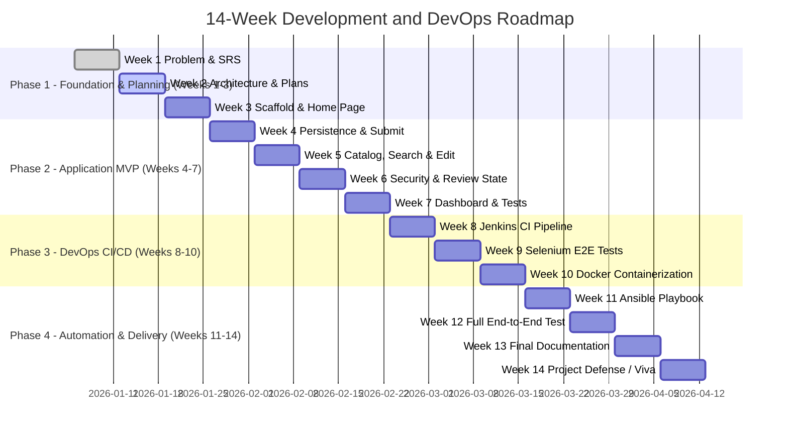

# 15-Task Development Plan and Agile Sprint Schedule

**Student:** Muawiyah Narvel  
**Roll Number:** 23108A0020  
**Project Title:** Jenkins-Based Research Paper Repository  
**Document Reference:** `docs/week-02/development-plan.md`  
**Current Phase:** Week 2 — Architecture & Design Planning  
**Target Delivery:** Weeks 3 through 14

---

## 1. Agile Framework & Execution Model

The project follows an **Agile Scrum/Kanban hybrid** methodology tailored for single-engineer academic delivery with strict faculty milestone tracking.

- **Cadence:** Sprints are organized by functional phase across 14 academic weeks.
- **WIP Limits:** Work In Progress (WIP) limit is set to **1** active implementation task at any given time to enforce disciplined code reviews, comprehensive testing, and verified commits.
- **Task Tracking States:**
  1. `Backlog` — Defined and scoped; prerequisites pending.
  2. `Ready` — Meets Definition of Ready (DoR); dependencies cleared.
  3. `In Progress` — Active coding or configuration on a designated feature branch.
  4. `In Review / Verification` — Automated tests passing locally, manual checks verified.
  5. `Done` — Meets Definition of Done (DoD); merged to `development` or `main`.

---

## 2. Definition of Ready (DoR) and Definition of Done (DoD)

### 2.1 Definition of Ready (DoR)
A task enters `Ready` only when:
1. The task is mapped to an approved user story ID (US-001 through US-017) and functional requirement ID.
2. Acceptance criteria are fully written, unambiguous, and testable.
3. Input validation boundaries, role authorization levels, and UI endpoints are documented.
4. All predecessor tasks and technical dependencies are in `Done` state.

### 2.2 Definition of Done (DoD)
A task is marked `Done` only when:
1. Code follows standard Java conventions and project package structure under `com.muawiyah.repository`.
2. All field-level validations and state machine transition rules are strictly enforced.
3. Submitter email privacy is preserved (never rendered on public catalog or detail views).
4. Submitter username is derived server-side from `Authentication.getName()` and marked immutable.
5. Automated JUnit 5 / Spring Boot tests verifying the feature pass without failure (`mvnw.cmd test`).
6. Code is reviewed against security constraints (no hardcoded passwords, CSRF enabled).
7. Feature branch is merged with a conventional commit message.
8. Relevant documentation and traceability matrices are updated.

---

## 3. Sprint Breakdown and 15-Task Kanban Mapping

### 3.1 Task-by-Task Implementation Matrix
| Task ID | Task Title | Target Sprint | Story Mapping | Prerequisites | Deliverables |
|---|---|---|---|---|---|
| **Task 1** | Environment & Toolchain Verification | Week 3 | US-001 | None | JDK 21 LTS verified, Git verified, Maven wrapper verified |
| **Task 2** | Spring Boot Scaffolding & Build Verification | Week 3 | US-001 | Task 1 | `pom.xml`, `RepositoryApplication.java`, context load test |
| **Task 3** | Version Control Baseline & Repo Init | Week 3 | US-001 | Task 2 | `.gitignore`, initial Git commit, `main` and `development` branches |
| **Task 4** | Public Home & Navigation Scaffold | Week 3 | US-001 | Task 2, 3 | `HomeController.java`, `index.html` (Thymeleaf/Bootstrap 5), layout |
| **Task 5** | Domain Model & In-Memory Persistence | Week 4 | US-002 | Task 2, 3 | `Paper.java` (12 fields), `ReviewStatus.java`, `PaperRepository.java` |
| **Task 6** | Research Paper Submission Workflow | Week 4 | US-002 | Task 5 | `PaperService.java`, `PaperController.java`, `submit.html` |
| **Task 7** | Public Catalog & Real-Time Search | Week 5 | US-003, US-004 | Task 5, 6 | `catalog.html`, `paper-detail.html`, search queries (privacy compliant) |
| **Task 8** | Paper Metadata Editing Workflow | Week 5 | US-005 | Task 6, 7 | `edit.html`, ownership validation, status reset logic |
| **Task 9** | In-Memory Role-Based Security Config | Week 6 | US-009 | Task 4, 7 | `SecurityConfig.java`, 3 dev roles (`researcher`, `reviewer`, `admin`) |
| **Task 10** | Peer-Review Workflow & State Machine | Week 6 | US-006, US-007 | Task 5, 8, 9 | Review action controllers, state machine validator, `review.html` |
| **Task 11** | Administrative Metrics Dashboard | Week 7 | US-008 | Task 5, 9, 10 | `DashboardController.java`, `dashboard.html`, status count queries |
| **Task 12** | Automated Integration & Unit Test Suite | Week 7 | US-010 | Tasks 5–11 | Unit tests, MockMvc controller tests, security access tests |
| **Task 13** | Jenkins CI Declarative Pipeline | Week 8 | US-011 | Task 12 | `Jenkinsfile` (Checkout, Compile, Test, Package stages) |
| **Task 14** | End-to-End Testing with Selenium | Week 9 | US-012 | Tasks 7, 10, 13 | Selenium WebDriver test suite for UI flows |
| **Task 15** | Containerization & Ansible Playbook | Weeks 10–11 | US-013, US-014 | Tasks 13, 14 | `Dockerfile`, `docker-compose.yml`, `site.yml` Ansible playbook |

---

## 4. Phase-Gated Review Milestones

- **Gate 1 (End of Week 3): Foundation Gate** — Clean build, passing context load test, working home page, clean Git history.
- **Gate 2 (End of Week 7): Application MVP Gate** — Full CRUD-minus-delete lifecycle, review workflow, role authorization, privacy enforcement, test coverage > 80%.
- **Gate 3 (End of Week 11): DevOps Automation Gate** — Jenkins CI automated build & test execution, Docker container build, Ansible deployment verified.
- **Gate 4 (End of Week 14): Final Project Defense Gate** — Live end-to-end demonstration, test reports, pipeline execution logs, project report.
