# Academic Evidence Collection and Audit Plan

**Student:** Muawiyah Narvel  
**Roll Number:** 23108A0020  
**Project Title:** Jenkins-Based Research Paper Repository  
**Document Reference:** `docs/week-02/evidence-plan.md`  
**Current Phase:** Week 2 — Architecture & Design Planning  
**Status:** ALL ARTIFACTS MARKED AS PLANNED (Unverified until genuine execution)

---

## 1. Purpose and Integrity Policy

To satisfy college academic requirements, syllabus audits, and external examiner evaluation, this repository maintains an explicit **Evidence Collection Plan**.

> [!IMPORTANT]
> **Academic Integrity Commitment:**  
> In accordance with strict engineering standards, **no evidence will be fabricated or claimed prior to actual execution**. All evidence items below are cataloged with their planned collection phase, commands, expected artifacts, and verification status.

---

## 2. Planned Evidence Matrix Across Project Phases

| Phase | Evidence Type | Generation Command / Source | Target Artifact Path | Verification Status |
|---|---|---|---|---|
| **Week 1** | Requirements & Problem Documents | Manual writing & Markdown verification | `docs/week-01/*.md` | **Verified & Approved** |
| **Week 2** | Architecture & Planning Specs | Architecture, ERD, and workflow design | `docs/week-02/*.md` | **In Progress** |
| **Week 3** | Environment & JDK Verification | `java -version`, `git --version` | Terminal logs recorded in Week 3 report | *Planned (Week 3)* |
| **Week 3** | Maven Build & Context Load Test | `mvnw.cmd clean test package` | `target/surefire-reports/` | *Planned (Week 3)* |
| **Week 3** | Git Baseline Commit Log | `git log --oneline --graph` | Terminal log & Git history | *Planned (Week 3)* |
| **Week 3** | Home Page UI Rendering | Browser view `http://localhost:8080/` | Screenshot in `docs/evidence/week-03/` | *Planned (Week 3)* |
| **Weeks 4–7** | Domain & Workflow Unit Test Reports | `mvnw.cmd test` | `target/surefire-reports/*.xml` | *Planned (Weeks 4–7)* |
| **Weeks 4–7** | Code Coverage Report | `mvnw.cmd jacoco:report` | `target/site/jacoco/index.html` | *Planned (Week 7)* |
| **Weeks 4–7** | Functional UI Workflow Verification | Browser inspection of submit/catalog/edit | Screenshots in `docs/evidence/week-07/` | *Planned (Week 7)* |
| **Week 8** | Jenkins Pipeline Console Output | Jenkins build job execution | Jenkins build log text export | *Planned (Week 8)* |
| **Week 8** | Jenkins Pipeline Stage View | Jenkins UI Dashboard | Screenshot in `docs/evidence/week-08/` | *Planned (Week 8)* |
| **Week 9** | Selenium WebDriver Test Execution | `mvnw.cmd test -Dtest=*Selenium*` | Surefire XML & browser test screenshots | *Planned (Week 9)* |
| **Week 10** | Docker Build and Container Inspection | `docker build`, `docker ps`, `docker logs`| Terminal output log | *Planned (Week 10)* |
| **Week 11** | Ansible Playbook Execution Output | `ansible-playbook -i hosts site.yml` | Terminal output log | *Planned (Week 11)* |
| **Weeks 12–14**| End-to-End System Demonstration | Live viva demo & defense logs | Final viva evaluation dossier | *Planned (Weeks 12–14)* |

---

## 3. DevOps Lifecycle Architecture

The end-to-end path from local source code to verified operation across all tools is depicted below:

```mermaid
flowchart LR
    subgraph Dev["1. Development (Local)"]
        Code["Java 21 / Spring Boot"] --> Git["Git Repository<br/>(Conventional Commits)"]
        Git --> Maven["Maven Wrapper<br/>(mvnw clean test)"]
    end

    subgraph CI["2. Continuous Integration (Jenkins)"]
        Maven -.->|Push Trigger| J_Build["Stage 1: Checkout & Build"]
        J_Build --> J_Test["Stage 2: JUnit 5 & MockMvc"]
        J_Test --> J_Package["Stage 3: JAR Packaging"]
        J_Package --> J_E2E["Stage 4: Selenium UI Tests"]
    end

    subgraph CD["3. Deployment & Operations (DevOps)"]
        J_E2E --> Docker["Docker Image Build<br/>(Multi-Stage Dockerfile)"]
        Docker --> Ansible["Ansible Provisioning<br/>(Configuration & Deployment)"]
        Ansible --> Live["Target Runtime<br/>(Verified Paper Repository)"]
    end
```



---

## 4. Evidence Storage Convention

All physical evidence captured during subsequent execution phases will be stored in a dedicated directory:
```
docs/evidence/
├── week-03/   # Initial build log, Git log, Home page screenshot
├── week-07/   # Surefire test XMLs, Jacoco coverage report, UI workflow screenshots
├── week-08/   # Jenkinsfile, pipeline build logs, stage view screenshot
├── week-09/   # Selenium test logs, browser execution screenshots
├── week-10/   # Dockerfile, container inspect logs
└── week-11/   # Ansible playbook logs
```
