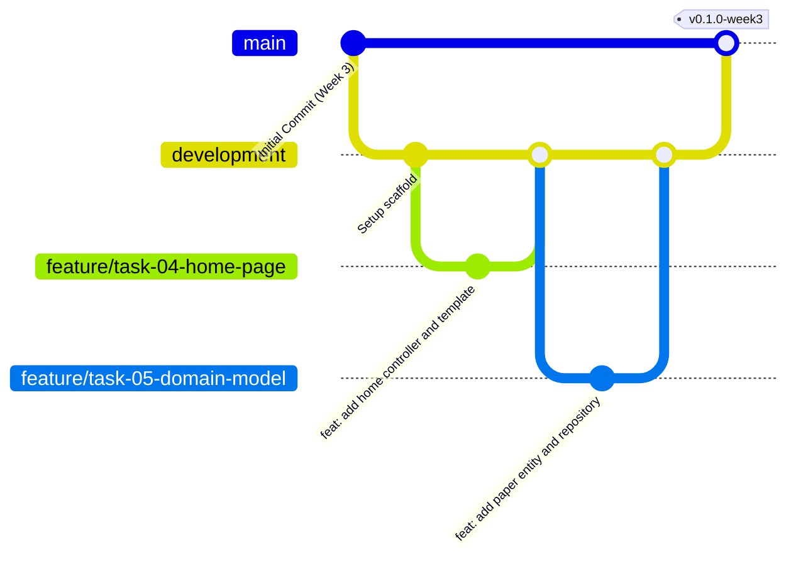

# Git Workflow, Branching Strategy, and Governance

**Student:** Muawiyah Narvel  
**Roll Number:** 23108A0020  
**Project Title:** Jenkins-Based Research Paper Repository  
**Document Reference:** `docs/week-02/git-workflow.md`  
**Current Phase:** Week 2 — Architecture & Design Planning  

---

## 1. Branching Model

The project adopts a streamlined **GitFlow / Feature-Branch** branching model structured around two permanent branches and temporary task-based feature branches:



### 1.1 Branch Taxonomy
1. **`main` (Production / Stable Baseline):**
   - Protected branch. Contains verified, production-ready milestone releases.
   - Every merge to `main` corresponds to a completed academic phase gate.
   - Jenkins CI runs full build, integration tests, and packaging on this branch.
2. **`development` (Integration Branch):**
   - Active working integration branch.
   - All completed feature branches merge here after local verification.
3. **`feature/task-<XX>-<short-description>` (Feature Branches):**
   - Short-lived branches created from `development` for individual tasks.
   - Example: `feature/task-04-home-page`, `feature/task-05-domain-model`.
   - Deleted after merging into `development`.

---

## 2. Conventional Commit Standards

All commits must follow the **Conventional Commits 1.0.0** specification.

### 2.1 Commit Structure
```
<type>(<scope>): <short imperative summary>

[optional detailed body explaining why and what changed]

[optional issue/task reference, e.g., Task-05, US-002]
```

### 2.2 Permitted Commit Types
- `feat`: A new user-facing or technical feature (e.g., `feat(catalog): add search by keyword and title`).
- `fix`: A bug fix or defect correction (e.g., `fix(security): prevent submitter email rendering on detail view`).
- `docs`: Documentation additions or revisions (e.g., `docs(week-02): complete database design specification`).
- `test`: Adding or correcting tests (e.g., `test(service): add unit tests for state machine transitions`).
- `refactor`: Code change that neither fixes a bug nor adds a feature.
- `chore`: Build configuration, dependency updates, `.gitignore` maintenance (e.g., `chore(maven): update dependencies`).
- `ci`: CI pipeline and DevOps configuration changes (e.g., `ci(jenkins): add automated test stage`).

---

## 3. Pull Request (PR) & Merge Verification Protocol

Before any feature branch is merged into `development`:
1. **Local Build Cleanliness:** Run `./mvnw clean test` (or `mvnw.cmd clean test` on Windows) to verify that all automated unit and integration tests pass.
2. **Review Checklist:**
   - [ ] No compilation warnings or test failures.
   - [ ] No hardcoded secrets, plain passwords, or sensitive tokens committed.
   - [ ] Submitter email privacy verified across all Thymeleaf templates.
   - [ ] Ownership verified server-side via `Authentication.getName()`.
   - [ ] State transitions conform strictly to the peer-review state machine.
3. **Merge Strategy:** Fast-forward or non-fast-forward (`--no-ff`) merge to retain clear branch history.

---

## 4. Repository Security and `.gitignore` Policy

To prevent credential leakage, platform artifacts, and IDE pollution from entering source control, the project maintains a strict `.gitignore` policy covering:

- **Build Output:** `/target/`, `*.class`, `*.jar`, `*.war`
- **IDE Metadata:** `.idea/`, `*.iml`, `.vscode/`, `.settings/`, `.classpath`, `.project`
- **OS Artifacts:** `Thumbs.db`, `desktop.ini`, `.DS_Store`
- **Log Files:** `*.log`, `/logs/`
- **Local Secrets:** `application-local.properties`, `*.pem`, `*.key`
