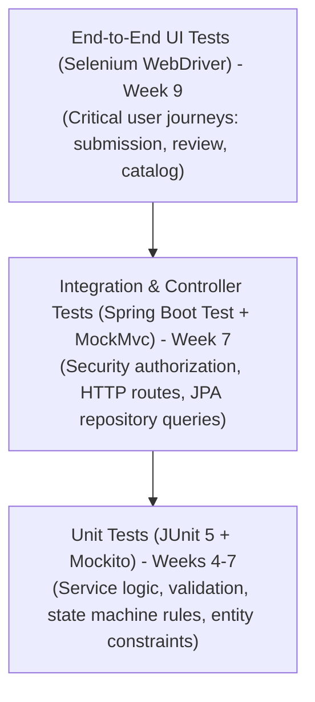

# Comprehensive Testing Strategy

**Student:** Muawiyah Narvel  
**Roll Number:** 23108A0020  
**Project Title:** Jenkins-Based Research Paper Repository  
**Document Reference:** `docs/week-02/testing-strategy.md`  
**Current Phase:** Week 2 — Architecture & Design Planning  
**Execution Milestones:** Weeks 3, 7, 8, and 9

---

## 1. Testing Philosophy and Test Pyramid

The repository adheres to the **Agile Test Pyramid** principle, emphasizing rapid, deterministic, automated unit and integration tests over brittle end-to-end UI tests.

| Layer | Tools | Scope & Focus | Target Execution Speed | Target Coverage |
|---|---|---|---|---|
| **Unit Tests** | JUnit 5, Mockito, AssertJ | Service business logic, state machine validation, entity rules | < 5 seconds total | > 80% line coverage |
| **Integration Tests** | `@SpringBootTest`, `MockMvc`, `@DataJpaTest` | HTTP endpoints, Spring Security role checks, JPA queries | < 15 seconds total | All 8 FR workflows |
| **E2E UI Tests** | Selenium WebDriver, Chrome Headless | Full browser submission, review actions, navigation | < 45 seconds total | Core smoke journeys |

---

## 2. Test Layer Specifications

### 2.1 Layer 1: Unit Testing (Weeks 4–7)
- **Frameworks:** JUnit 5 (`org.junit.jupiter`), Mockito 5 (`org.mockito`).
- **Focus Areas:**
  - `PaperServiceTest`: Verifies business logic in isolation with mocked `PaperRepository`.
  - State machine transition tests: Explicitly tests all permitted transitions and asserts that invalid transitions throw `IllegalStateException`.
  - Terminal state immutability: Asserts that attempting to transition out of `ACCEPTED` or `REJECTED` throws an exception.
  - Ownership verification: Asserts that an author modifying a paper must match `submitterUsername`.

### 2.2 Layer 2: Integration & Controller Testing (Weeks 6–7)
- **Frameworks:** Spring Boot Test, `MockMvc`, `@WithMockUser`.
- **Focus Areas:**
  - `SecurityIntegrationTest`:
    - Anonymous users can access `GET /`, `GET /papers`, `GET /papers/{id}`.
    - Anonymous users attempting `GET /papers/new` are redirected to `/login`.
    - User with `ROLE_RESEARCHER` can submit papers.
    - User with `ROLE_REVIEWER` can post status updates to `POST /papers/{id}/status`.
    - User with `ROLE_RESEARCHER` is forbidden (`403 Forbidden`) from calling `POST /papers/{id}/status`.
  - `CatalogPrivacyTest`:
    - Asserts that responses from `GET /papers` and `GET /papers/{id}` do not contain the `submitterEmail` string in the rendered HTML body.
  - `SearchIntegrationTest`:
    - Verifies case-insensitive partial matching for title, author, and keywords.
    - Verifies empty query returns all papers.
    - Verifies unmatched query returns empty catalog message.

### 2.3 Layer 3: End-to-End Browser Testing (Week 9)
- **Framework:** Selenium WebDriver with headless Chrome.
- **Critical Journeys Covered:**
  1. Researcher logs in -> navigates to submission -> submits valid paper -> verifies paper appears in catalog.
  2. Reviewer logs in -> navigates to submitted paper -> updates status to `UNDER_REVIEW` -> updates status to `ACCEPTED`.
  3. Public visitor browses catalog -> executes keyword search -> opens detail page -> verifies submitter email is absent.

---

## 3. Test Isolation and Data Management

To ensure deterministic, reproducible test results:
1. **Clean Baseline:** Tests execute against the volatile H2 in-memory database (`jdbc:h2:mem:testdb`).
2. **Transaction Rollback:** Integration test methods are annotated with `@Transactional`, rolling back all database writes upon method completion.
3. **No Flaky Tests:** Tests do not depend on network calls, external internet connectivity, or specific execution order.

---

## 4. Quality Gates & Failure Criteria

The Maven build and Jenkins CI pipeline will fail under any of the following conditions:
1. Any JUnit test failure or uncaught error (`mvnw test` exits with non-zero code).
2. Code coverage on core service and controller packages drops below 75%.
3. Any test attempts to bypass Spring Security filters.
